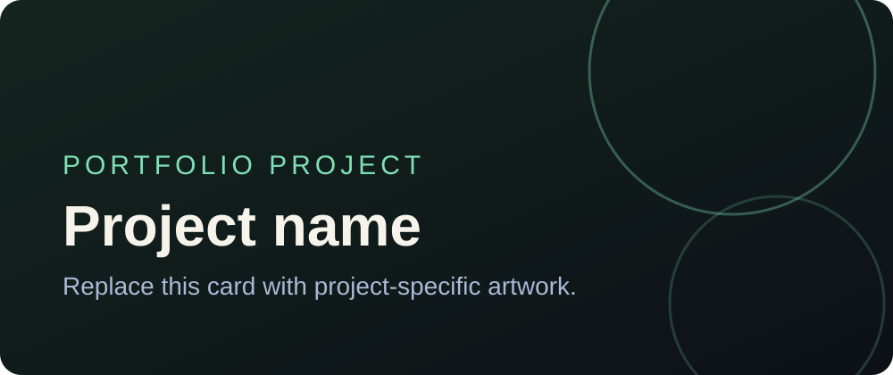
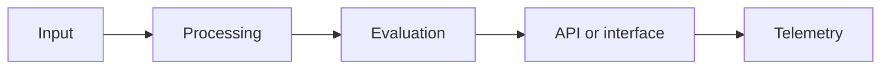

# Project name

One sentence explaining the user problem, who it serves, and the measurable outcome.



## Why this exists

Describe the real problem, constraints, and why the project is worth building. Avoid generic claims; include evidence or a concrete use case.

## What it does

- Core capability
- Important engineering or product decision
- Safety, reliability, privacy, or performance behavior

## Architecture



Explain component responsibilities and important data flows.

## Evaluation

Document how quality is measured. Include:

- dataset or test-set construction
- baseline
- metrics and thresholds
- failure categories
- results and known limitations

| Measure | Baseline | Current | Target |
|---|---:|---:|---:|
| Example quality metric | — | — | — |
| P95 latency | — | — | — |

## Run locally

```bash
git clone https://github.com/SBusienei/REPOSITORY_NAME.git
cd REPOSITORY_NAME
# Add setup and run commands
```

Document required environment variables in `.env.example`. Never commit secrets.

## Tests

```bash
# Add the smallest command that validates the project
```

## Repository structure

```text
.
├── docs/
├── src/
├── tests/
├── portfolio.yml
└── README.md
```

## Decisions and trade-offs

Record the choices a reviewer cannot infer from the code, including rejected alternatives.

## Limitations and next steps

Be explicit about unsupported cases and the next measurable improvement.

## Portfolio publishing

1. Update `portfolio.yml` with accurate public metadata.
2. Add the `portfolio` repository topic under **About → Settings**.
3. Keep the repository public and unarchived.
4. Wait for the portfolio project workflow to open an assigned pull request.
5. Review and merge the pull request to publish the card.

Removing the `portfolio` topic removes the repository from the next proposed portfolio update.

## License

Choose an appropriate license before inviting reuse. See [LICENSE.md](LICENSE.md) for guidance.
